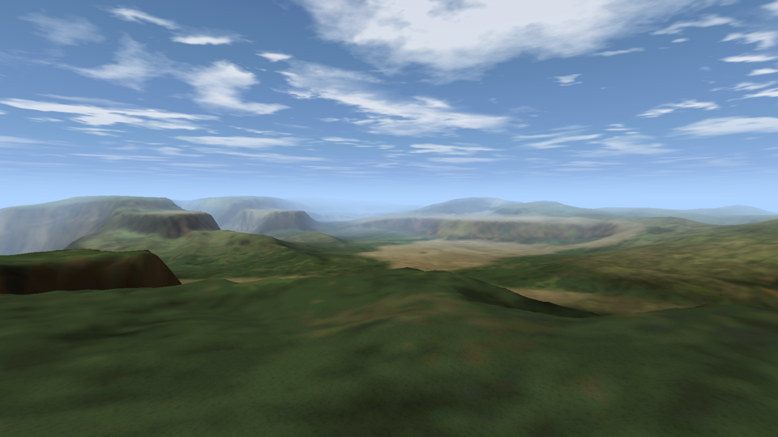
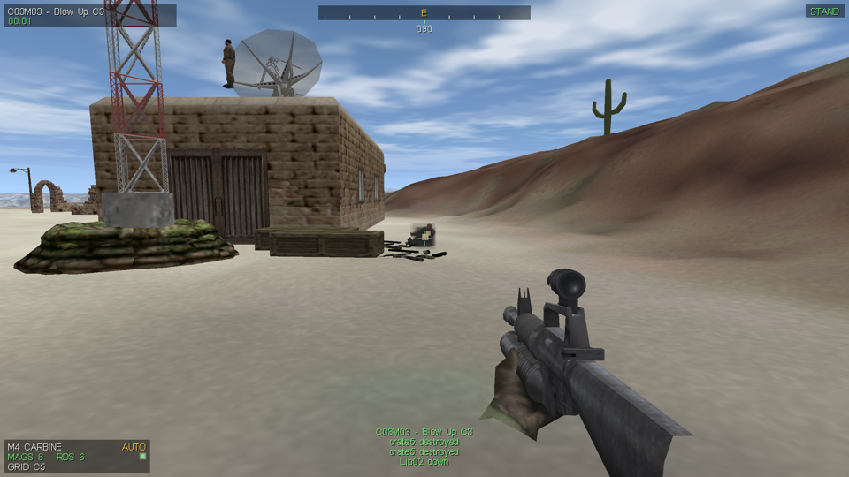
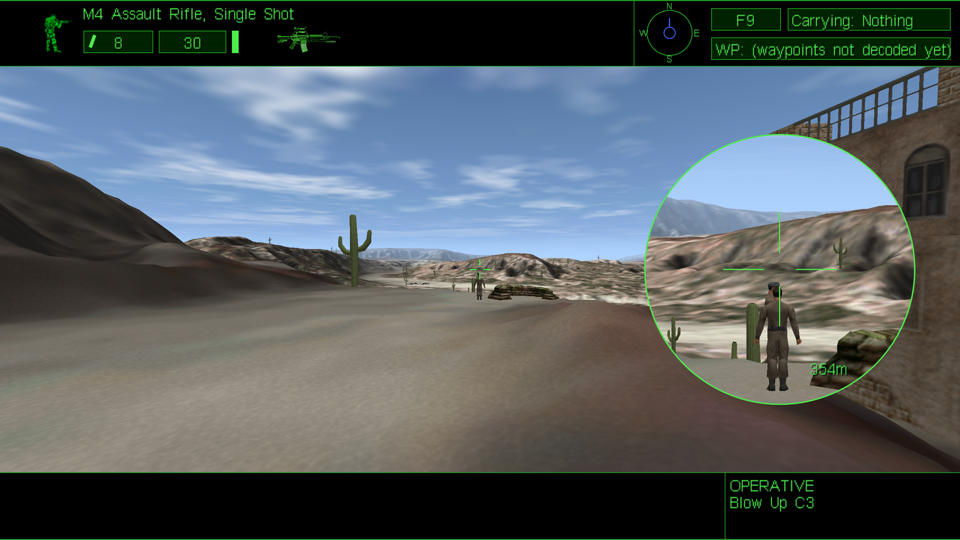
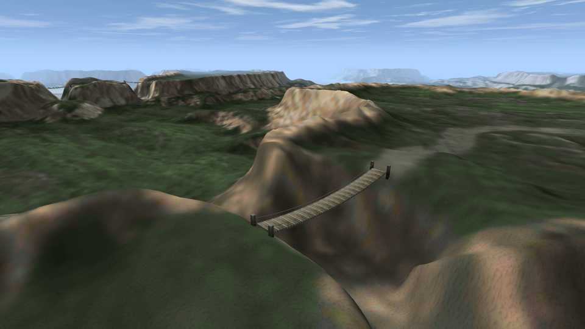
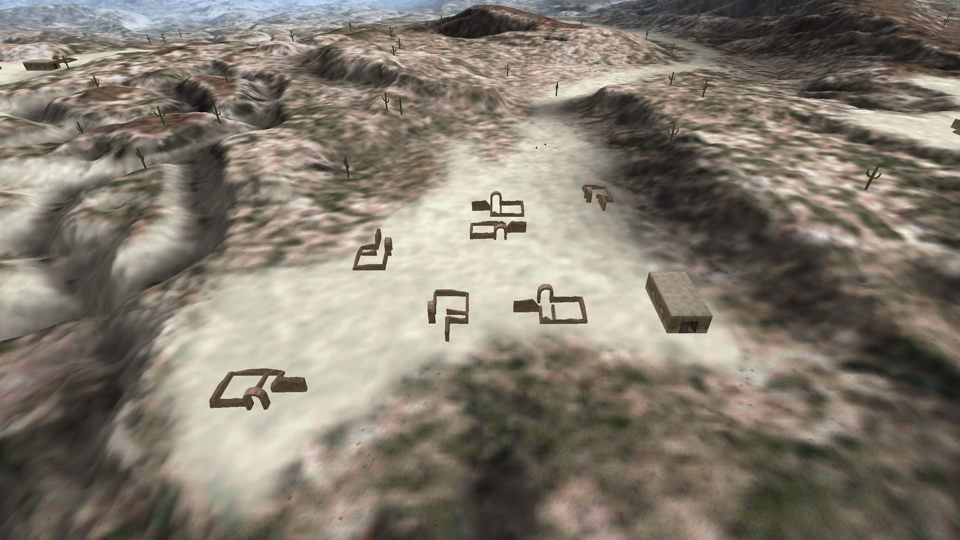

# OpenDF

A cross-platform (Windows / macOS / Linux) reimplementation of the engine of
NovaLogic's **Delta Force** (1998). It contains no game data. It reads the files
from your own copy of the CD.



## Status

You can walk around every mission in first person and shoot, but **enemies
don't react yet** (AI is milestone 6), so it is not a game yet. What works today:

| Area | State |
|---|---|
| PFF3 archives (`DF.PFF`, `DFBASE.PFF`) | ✅ read |
| PFF2 archives (`MISSIONS.PFF`, `AUDIO.PFF`, `VIEWS.PFF`), encrypted | ✅ decrypted on the fly |
| Extract / list tool | ✅ |
| PCX images and palettes | ✅ |
| `.TRN` terrain descriptors | ✅ |
| Terrain rendering: colour and elevation maps, detail tiles, sky, clouds, water, haze, endless wrap-around | ✅ (1 m per pixel, calibrated from mission data) |
| Free-fly and walk camera with ground collision | ✅ |
| `.3DI` models (every object, vehicle, soldier, weapon): textures, LODs, materials, transparency, shadows | ✅ 359 of 362 load; the other 3 are damaged or unused on the disc |
| Model viewer, and placing objects in the world at real scale | ✅ |
| `ITEMS.DEF`, `.BMS` missions: every object placed with position, height and heading; player start | ✅ all 62 missions, 26,510 objects |
| First-person soldier: run/walk, jump, stand/crouch/prone, collision with buildings and objects (the models' own collision volumes), standing on bridges | ✅ |
| Weapons with the original names, fire modes, first-person placement and scopes (from `DF.EXE`): SpecOps .45, M4 (single shot / burst), M40, H&K MP5 SD (single / burst / full auto), SAW; magazines, reloads, recoil, bullet drop and travel time, muzzle flash | ✅ (ballistic numbers are real-world approximations) |
| Damage: people go down, crates/barrels/etc. break into their `husk` wreck models | ✅ |
| The original's HUD: top and bottom bars with the game's own stance icons, weapon silhouettes and font; compass, grid square, carrying box, messages; the zoom view as a magnified circle with a range readout; command map (C) | ✅ (waypoint box empty until `.JIM` is decoded) |
| Knife, grenades, M203, binoculars, laser designator; player health | ⏳ |
| Mission triggers/objectives, AI state, waypoint names (`.JIM`) | ⏳ |
| Soldier animation (`.ANM`, `PLAYER01.CHR`) | ⏳ |
| Weapons, AI soldiers, mission scripting, HUD, menus | ⏳ |
| Audio (WAV/MIDI in `AUDIO.PFF`, `DFMUSIC.SBF`), `.KDV` video | ⏳ |
| NovaWorld multiplayer | ❌ out of scope for now |

See [docs/ROADMAP.md](docs/ROADMAP.md) for the plan and
[docs/FORMATS.md](docs/FORMATS.md) for what is known about the file formats.

## Building

Requirements: a C++17 compiler, CMake ≥ 3.16, an OpenGL 3.3 capable GPU.
SDL2 is used if installed; otherwise CMake downloads and builds it.

**macOS**
```bash
brew install cmake sdl2
```
```bash
cmake -S . -B build && cmake --build build -j
```

**Linux (Debian/Ubuntu)**
```bash
sudo apt install build-essential cmake libsdl2-dev
```
```bash
cmake -S . -B build && cmake --build build -j
```

**Windows (Visual Studio 2019+)**
```bash
cmake -S . -B build
```
```bash
cmake --build build --config Release
```
The executable is `build\Release\opendf.exe`.

## Running

Games live in `games/`, one folder per game (see [games/README.md](games/README.md)).
Import your Delta Force CD into `games/DeltaForce` from the mounted disc or a
disc image (`.iso`, `.bin`/`.cue`, `.img`):

```bash
./build/opendf import /Volumes/DELTAFORCE   # or D:\, or DeltaForce.iso
```

Then start OpenDF. Without `--game` it opens the launcher, a Delta Force
styled screen listing your games (the ones in `games/` are added on the first
start; add others with *Add game*) that starts the chosen game's own front end
([docs/LAUNCHER.md](docs/LAUNCHER.md)):

```bash
./build/opendf
```

Or skip the launcher with `--game` pointing at the game's folder:

```bash
./build/opendf --game games/DeltaForce play             # the game's own menus
./build/opendf --game games/DeltaForce mission C02M01   # straight into a mission
```

Values that
only exist in the original executable (weapon tables, key bindings, …) are read
from the game's own `DFSETUP/DF.EXE`.

| Command | Purpose |
|---|---|
| `opendf` / `opendf launcher [add]` | the launcher: pick one of your games (`add`: open on the add-a-game screen) |
| `opendf --game ROOT play` | the game's own front end (Delta Force or Delta Force 2) |
| `opendf import SOURCE [DEST]` | copy a game from its disc, a folder or a disc image into `games/` (Delta Force 2's fake file sizes are cut back to the real ones) |
| `opendf --game ROOT [--terrain DFG1] [--size 1600x900]` | terrain viewer |
| `opendf --game ROOT mission [C02M01]` | play a mission in first person, starting where the player starts |
| `opendf --game ROOT models [HUMVEE]` | browse all 362 `.3DI` models |
| `opendf --game ROOT check` | parse every model, terrain, image and mission and report failures |
| `--camera X,Y,HEIGHT,YAW,PITCH` | start at map metres X (east), Y (north), HEIGHT above ground, facing compass YAW, PITCH (degrees) |
| `opendf --game ROOT list [.EXT]` | list every file in the archives |
| `opendf --game ROOT extract OUTDIR [.EXT]` | extract files (encrypted ones decoded) |

Viewer controls: mouse to look, **WASD** to move, **Shift** to go faster,
**Space / C** for up / down, **F** to switch between walking and flying,
**Tab / Shift+Tab** for the next / previous terrain (or mission, in `mission` mode), **[ ]** for height scale,
**- =** for view distance, **M** to place a row of sample objects in front of you
(soldier, hostage, Humvee, pickup, crates, trees, hut, barracks, tower, Black Hawk),
**N** to clear them, and **Esc** to release the mouse and then quit.

Mission controls follow the original keyboard layout where it doesn't clash
with mouse + WASD:

| Action | Keys |
|---|---|
| Look / fire / zoom or scope | mouse / left button or Ctrl / right button |
| Move | WASD or arrow keys (running is the default, Shift walks), Space jumps |
| Stand / crouch / prone | Delete / End / Page Down (original keys), or X / Z to toggle crouch / prone |
| Weapons | 2 .45 pistol, 3 / 4 M4 single shot / burst, 6 M40 sniper, 7 MP5 SD (again: next fire mode), 8 SAW, Backspace cycles |
| Zoom view | right mouse button (cycles the weapon's magnifications, then off) |
| Change magazine | M (original key) or R |
| Command map (zoom in / out) / goals | C (- / =) / G |
| Crosshair / gun on-off | F3 / F4 (original keys) |
| Debug flight / next mission | N / Tab |





Model viewer controls: drag to orbit, mouse wheel to zoom, **Tab / Shift+Tab** for
the next / previous model, **PageUp / PageDown** to jump 10, **L** to cycle the
level of detail. The title bar shows the size in metres.





## Legal

OpenDF is an independent engine. You need an original copy of Delta Force;
none of the game's assets are included in or distributed with this project.
