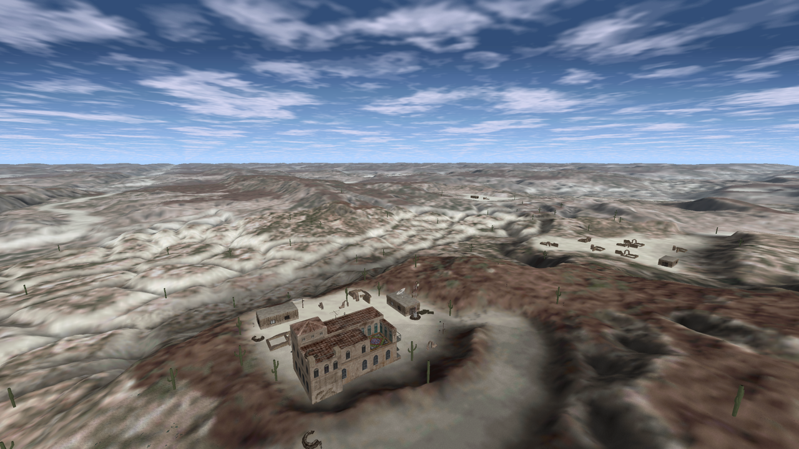
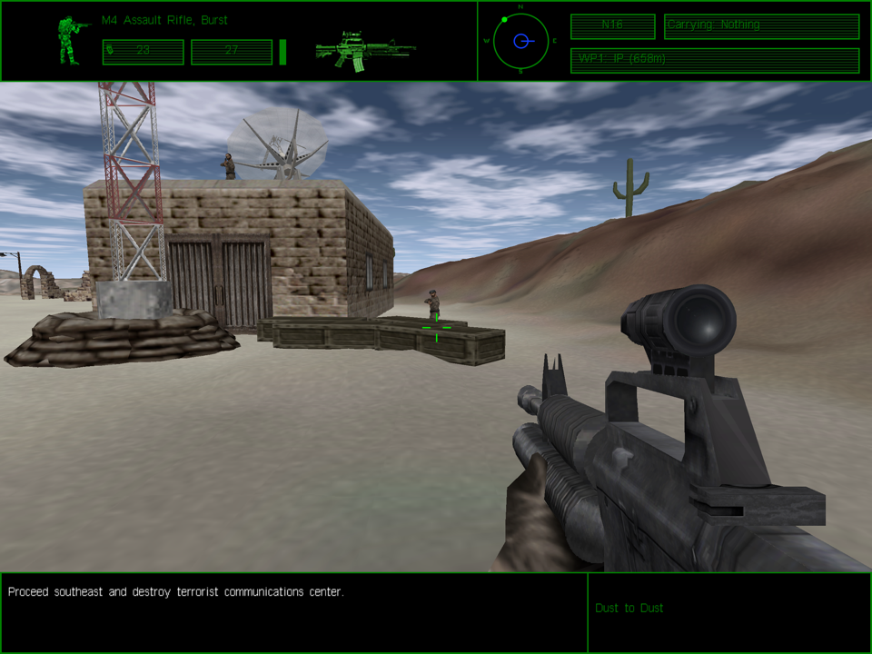
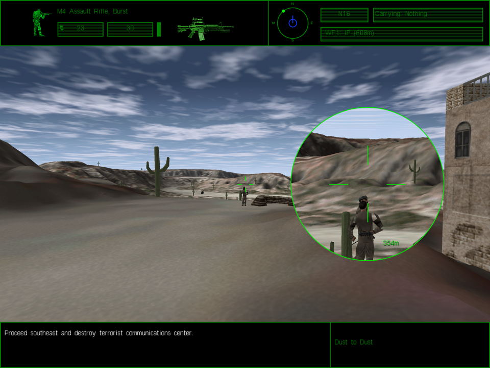
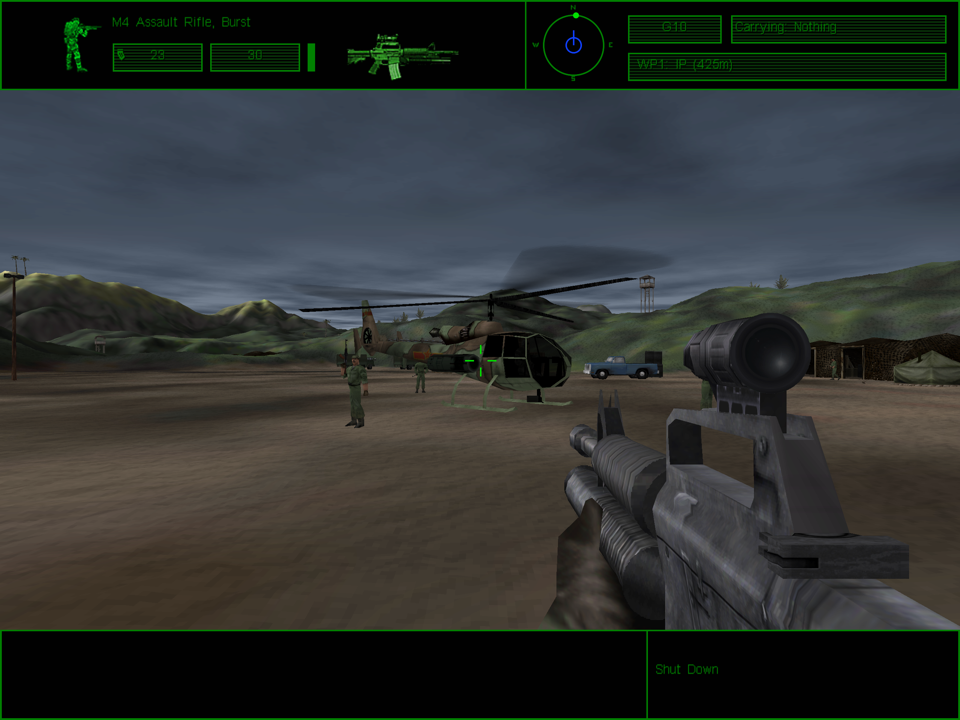
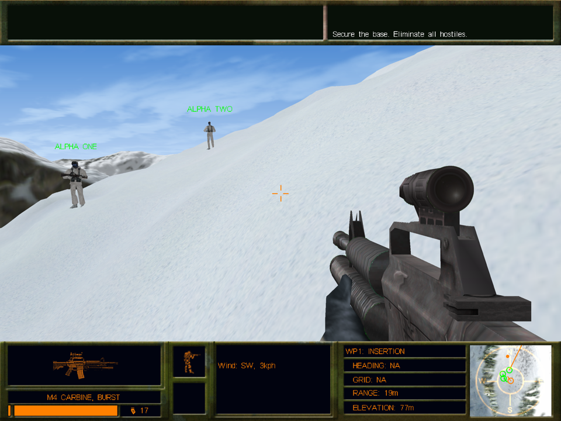
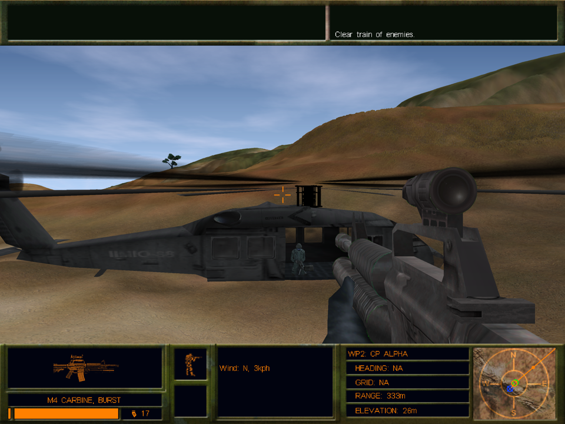
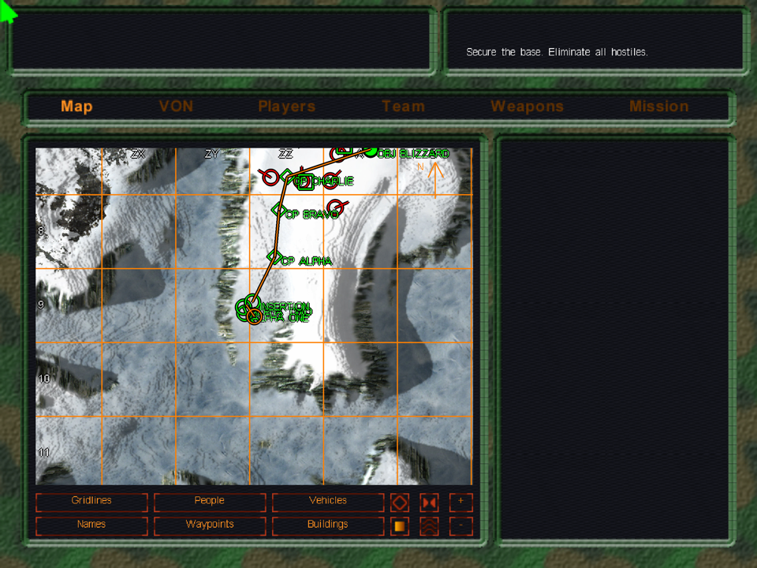
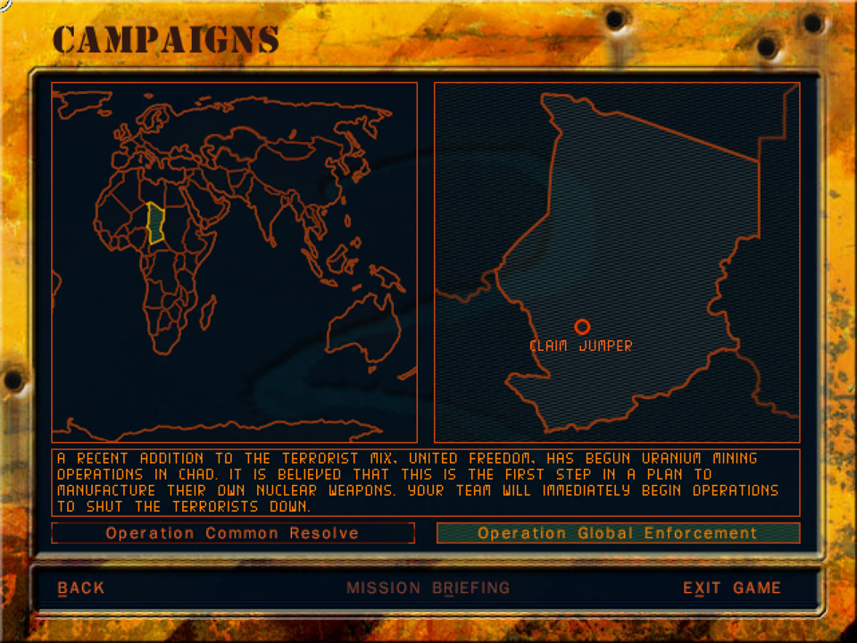
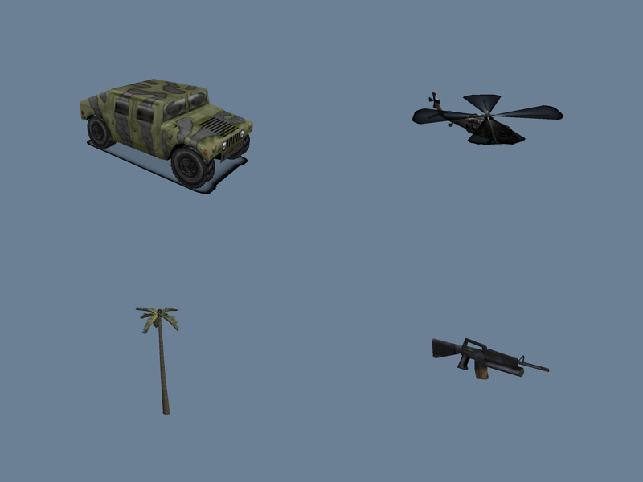
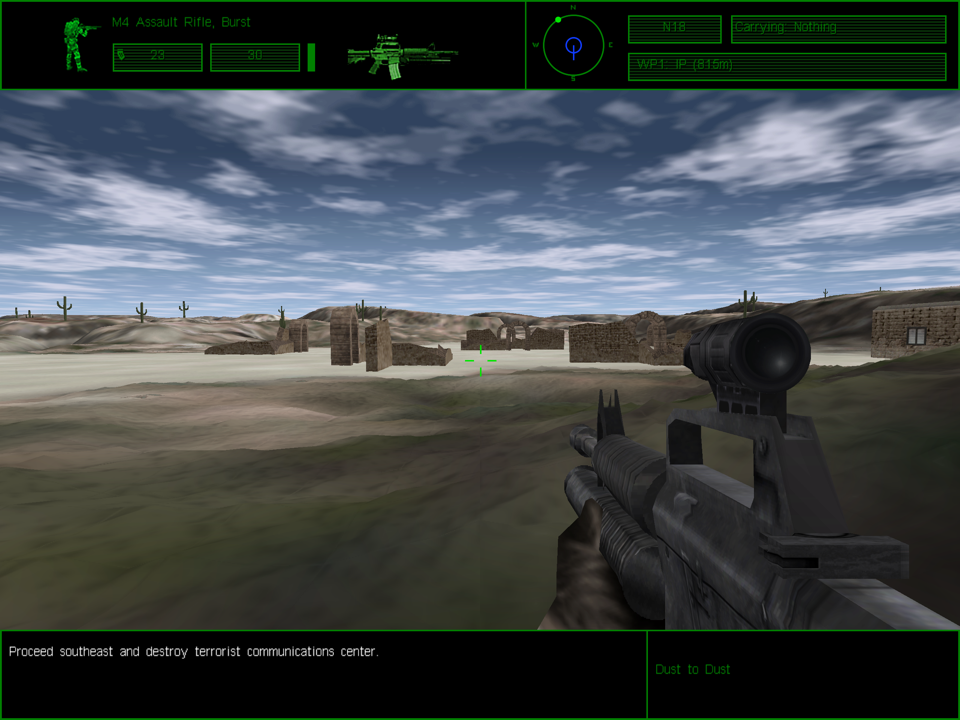

# OpenDF

A cross-platform (Windows / macOS / Linux) reimplementation of the engines of
NovaLogic's **Delta Force** (1998) and **Delta Force 2** (1999). It contains no
game data. It reads the files from your own copy of the games: the original CDs
or the GOG releases.



## Status

Both games are playable in single player through their own front ends: menus,
soldier profiles, campaigns, briefings, missions with AI, vehicles and
helicopters, sound and music, the intro movies and the debriefing. Behaviour
comes from the original executables, which were audited function by function;
the reference is the GOG builds (Delta Force 1.00.03.03p, Delta Force 2
1.06.15). [docs/AUDIT-FIXES.md](docs/AUDIT-FIXES.md) lists everything the
2026-11 audits fixed.

| Area | State |
|---|---|
| Game data: PFF2/PFF3 archives (encrypted ones decrypted), the GOG Delta Force's scrambled `ITEMS.DEF` / `LOOP.DEF` / `.ANM` | ✅ CD and GOG installs |
| Tables from the game's own `DF.EXE` / `DF2.EXE` (weapons, keys, sounds, voices) | ✅ CD and GOG builds recognised; unknown builds tried against both table sets, built-in values as the last fallback |
| Terrain, sky, clouds, water, weather, models (`.3DI` v5 and v8), skinned soldiers (`.CHR`, `PLAYER01.KSA`) | ✅ |
| Missions (`.BMS`), events and objectives, AI soldiers, vehicles, helicopters, wildlife | ✅ all of Delta Force's 62 missions; Delta Force 2's single-player and quick missions |
| Player: movement, stances, swimming, ladders, parachute, every weapon, ballistics (drop, drag, penetration, tracers), damage | ✅ |
| Each game's own HUD, command map, goals, messages, outside views | ✅ |
| Front ends from `DF.MNU` / `DF2.MNU`: soldiers, campaigns, briefing maps, gear, settings, key bindings, credits, debriefing | ✅ |
| Sound effects, radio chatter, menu music (`DFMUSIC.SBF` / `DF2MUSIC.SBF`) | ✅ |
| Intro movies (KDV, Bink 1) | ✅ |
| Delta Force's piranhas and penguins | ⏳ do nothing yet ([AUDIT X28](docs/AUDIT.md)) |
| Land Warrior, Task Force Dagger | ⏳ recognised and listed in the launcher, not playable ([docs/OTHER-GAMES.md](docs/OTHER-GAMES.md)) |
| NovaWorld / LAN multiplayer | ❌ out of scope for now |

See [docs/ROADMAP.md](docs/ROADMAP.md) for the plan,
[docs/FORMATS.md](docs/FORMATS.md) for what is known about the file formats,
[docs/VERIFICATION.md](docs/VERIFICATION.md) and [docs/AUDIT.md](docs/AUDIT.md) for where
each value comes from, and [docs/OTHER-GAMES.md](docs/OTHER-GAMES.md) for Delta Force 2
and the later games.

## Building

Requirements: a C++17 compiler, CMake ≥ 3.16, an OpenGL 3.3 capable GPU.
SDL2 is used if installed; otherwise CMake downloads and builds it
(`-DOPENDF_FETCH_SDL2=OFF` turns that off). libjpeg is optional but needed for
Delta Force 2, whose terrain colour maps, menu pictures and briefing maps are
JPEGs.

**macOS**
```bash
brew install cmake sdl2 jpeg
```
```bash
cmake -S . -B build && cmake --build build -j
```

**Linux (Debian/Ubuntu)**
```bash
sudo apt install build-essential cmake libsdl2-dev libjpeg-dev
```
```bash
cmake -S . -B build && cmake --build build -j
```

**Windows (Visual Studio 2019+)**
```bash
cmake -S . -B build
```
```bash
cmake --build build --config Release
```
The executable is `build\Release\opendf.exe`.

## Running

Games live in `games/`, one folder per game (see [games/README.md](games/README.md)),
but any folder works. OpenDF takes the original CD release or the GOG release
of each game.

**CD:** import the disc into `games/DeltaForce` or `games/DF2` from the mounted
disc or a disc image (`.iso`, `.bin`/`.cue`, `.img`). Use the importer rather
than a plain copy: the Delta Force 2 CD lists its archives at about ten times
their real size, and the importer cuts them back.

```bash
./build/opendf import /Volumes/DELTAFORCE   # or D:\, or DeltaForce.iso
```

**GOG:** point OpenDF at the installed game folder, the one with `Df.exe` or
`Df2.exe` next to the `.pff` archives (add it in the launcher, or pass it to
`--game`). GOG's offline installer (`setup_delta_force_*.exe`) is not read
directly; on macOS or Linux it can be unpacked with
[innoextract](https://constexpr.org/innoextract/), which puts the game in an
`app` folder:

```bash
innoextract -d games/GOG/DF2 'setup_delta_force_2_1.06.15_(10721).exe'
./build/opendf --game games/GOG/DF2/app play
```

In the launcher, choosing `games/GOG/DF2` is enough: it takes the `app` folder
inside. The GOG builds are OpenDF's reference; where the CD and GOG executables
behave differently, each install gets its own executable's behaviour.

Then start OpenDF. Without `--game` it opens the launcher, a Delta Force
styled screen listing your games (the folders directly in `games/` are added on the first
start; add others with *Add game*) that starts the chosen game's own front end
([docs/LAUNCHER.md](docs/LAUNCHER.md)):

```bash
./build/opendf
```

Or skip the launcher with `--game` pointing at the game's folder:

```bash
./build/opendf --game games/DeltaForce play             # the game's own menus
./build/opendf --game games/DeltaForce mission C02M01   # straight into a mission
```

Values that
only exist in the original executable (weapon tables, key bindings, sounds, …) are read
from the game's own executable: `DFSETUP/DF.EXE` / `DF2SETUP/DF2.EXE` on the CD,
`Df.exe` / `Df2.exe` in a GOG folder ([docs/FORMATS.md](docs/FORMATS.md#game-executables-cd-and-gog-builds)).

| Command | Purpose |
|---|---|
| `opendf` / `opendf launcher [add]` | the launcher: pick one of your games (`add`: open on the add-a-game screen) |
| `opendf --game ROOT play` | the game's own front end (Delta Force or Delta Force 2) |
| `opendf import SOURCE [DEST]` | copy a game from its disc, a folder or a disc image into `games/` (Delta Force 2's fake file sizes are cut back to the real ones); DEST is needed when SOURCE is not a CD layout, e.g. a GOG folder |
| `opendf --game ROOT [view] [--terrain DFG1]` | terrain viewer |
| `opendf --game ROOT mission [C02M01]` | play a mission in first person, starting where the player starts |
| `opendf --game ROOT models [HUMVEE]` | browse the game's `.3DI` models |
| `opendf --game ROOT check` | parse every model, terrain, image and mission and report failures |
| `opendf --game ROOT list [.EXT]` | list every file in the archives |
| `opendf --game ROOT extract OUTDIR [.EXT]` | extract files (encrypted ones decoded) |
| `opendf --game ROOT chr` | print the stance heights and head sphere from `PLAYER01.CHR` |
| `opendf kdv FILE [OUTDIR [EVERY]]` | decode a KDV video (Delta Force's intro), every EVERY-th frame to OUTDIR |
| `opendf bink FILE [OUTDIR [EVERY\|N,N,...]]` | decode a Bink 1 video (Delta Force 2's intro): frames and `audio.wav` to OUTDIR |
| `--camera X,Y,HEIGHT,YAW,PITCH` | start at map metres X (east), Y (north), HEIGHT above ground, facing compass YAW, PITCH (degrees) |
| `--size WxH` | window size of the viewers and of a direct `mission` run (default 1280x720) |
| `--fullscreen` / `--windowed` | start fullscreen or in a window (default: as last time) |
| `--settings FILE` | use FILE instead of `opendf.ini` (the launcher's list and the fullscreen setting) |

Test runs (`--screenshot`, `--frames`, `--input`, `--record`, `--watch`, …) and
the `OPENDF_*` debugging variables are described in [docs/TESTING.md](docs/TESTING.md).

**Fullscreen:** **Alt+Enter** (on macOS also **Cmd+Ctrl+F** or **Cmd+F**) switches between a
window and fullscreen anywhere: the launcher, both games' menus, missions and the viewers.
It is OpenDF's own desktop fullscreen (the screens are scaled with the aspect ratio kept) and
is remembered in `opendf.ini` ([docs/LAUNCHER.md](docs/LAUNCHER.md#fullscreen)). F11 is left
alone: it is Delta Force's contour map key.

Viewer controls: mouse to look, **WASD** to move, **Shift** to go faster,
**Space / C** for up / down, **F** to switch between walking and flying,
**Tab / Shift+Tab** for the next / previous terrain, **[ ]** for height scale,
**- =** for view distance, **M** to place a row of sample objects in front of you
(soldier, hostage, Humvee, pickup, crates, trees, hut, barracks, tower, Black Hawk),
**N** to clear them, and **Esc** to release the mouse and then quit.

Mission controls are the original game's: its default key table is read from
the game's executable, and the soldier's own bindings (set in the front end's
controls screen) apply on top. The mouse is added as a modern amenity. Delta
Force's defaults:

| Action | Keys |
|---|---|
| Look / fire / scope | mouse / left button or Ctrl / right button or S (cycles the weapon's magnifications, then off) |
| Move | arrow keys (running is the default, Shift walks), Space jumps; keypad 4 / 6 turn, 8 / 2 look up / down, 5 centres the view |
| Stand / crouch / prone | Delete / End / Page Down |
| Weapons | 0-9 the loadout's slots (0 laser designator, 1 knife, 2 sidearm, 3-5 primary weapon modes, 6-8 kit, 9 frag grenade), Backspace cycles, mouse wheel steps |
| Change magazine / drop | M / D |
| Command map (zoom in / out) / goals / briefing | C (= / -) / G / O |
| Waypoints next / previous | W / E (E: GOG build) |
| Binoculars / show friendlies / old messages | B / F / R |
| Help / crosshair / gun on-off | F1 / F3 / F4 |
| First-person and outside views | F2 / F5 / F6 / F7, camera keys L ; P . [ ] |
| Picture-in-picture / forward observer (next team-mate) | F8 / F9 (Tab) |
| GPS terrain / elevation inset, letterbox | F10 / F11, F12 |
| Audio macros, pause | A (GOG build), Pause |
| End mission | Escape, then Y / N |
| Debug flight (OpenDF's own) | N (Ctrl+N in Delta Force 2) |

Delta Force 2 uses its own table from `DF2.EXE` (for example N night vision,
X / Z scope zeroing, E scope magnification); its help screen (F1) lists them.















Model viewer controls: drag to orbit, mouse wheel to zoom, **Tab / Shift+Tab** for
the next / previous model, **PageUp / PageDown** to jump 10, **L** to cycle the
level of detail. The title bar shows the size in metres.





## Legal

OpenDF is an independent engine. You need an original copy of Delta Force or
Delta Force 2 (the CD or the GOG release); none of the games' assets are
included in or distributed with this project.
