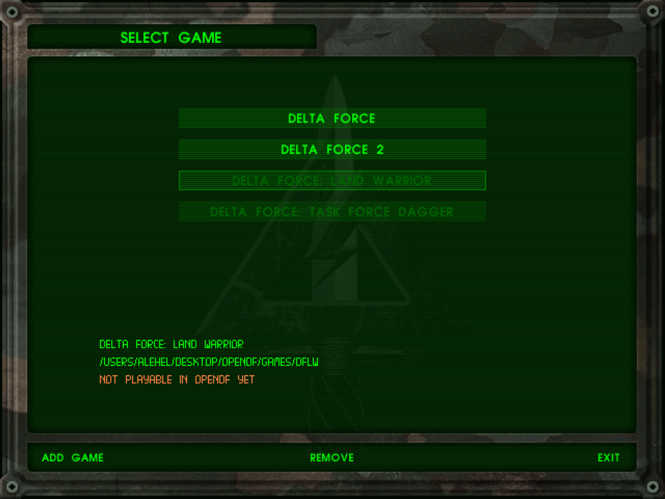

# The launcher

Started without `--game`, OpenDF opens a full-window launcher listing the
Delta Force games you have added. Choosing one starts that game's own front
end: Delta Force's menus (`DF.MNU`, `runFrontend`) or Delta Force 2's
(`DF2.MNU`, `runFrontendDf2`). When you leave the game, you return to the
launcher. With `--game` on the command line the launcher is skipped, as
before.



## An OpenDF screen in a Delta Force game's clothes

None of the NovaLogic games had a launcher like this, so it is an original
OpenDF screen. It has no art of its own: it borrows the menu art and fonts of
a game you have added, on the 640x480 layout of that game's Main Menu, scaled
to fit the window with the aspect ratio kept (as the front ends are):

| Look | Used when | Art and fonts (from the game's own `.MNU`) |
|---|---|---|
| Delta Force | Delta Force was played last, or no game was played yet and Delta Force is added | `ImageTemplate` (`DF_BKGD.PCX`), the `ImageBtn296` button strip (`BTN_296.PCX`, 4 frames, the menus' translucent blend), `AVA14B` title at 165,27, `AVA12B` buttons from 172,104 every 30, `AVA10B` along the bottom (y 434), `LCD10` for details; `TrueGreen` / `LightRed` / `DarkGrey` |
| Delta Force 2 | Delta Force 2 was played last, or it is the only one added | `ImageMenuFrame` (`DF2_MAIN.JPG`), `ImageBtn01` (`DF2_BT01.PCX`), `STP26` title at 37,16, `FRK14N` buttons from 172,80, the `mm_Rect` box (`0xCA4409`) with `LCD10N` text, `FRK12N` along the bottom; the `AMBER_*` colours |
| OpenDF's own | no Delta Force or Delta Force 2 added yet | a dark panel in Delta Force's menu green with OpenDF's built-in 5x7 capitals, so the first game can still be added |

## The list

- One button per added game, in the order they were added; the one played
  last is highlighted at start.
- Land Warrior and Task Force Dagger are recognised and listed, but greyed out
  with "Not playable in OpenDF yet". A folder that has gone missing (an
  unplugged drive) is greyed out too, with its path shown so it can be
  reconnected or removed.
- Below the buttons: the highlighted game's name, folder and state.
- Mouse: hover highlights, click starts. Keys: Up/Down, Home/End, Enter or
  Space starts, `A`/Insert adds, Delete/Backspace removes (press twice),
  Esc quits.
- *Remove* only takes the game off the list; its files are not touched.

## Adding a game

*Add game* opens a text box: type or paste (Ctrl/Cmd+V) the folder where the
game's CD was copied (`opendf import` puts them in `games/NAME`) and press
Enter, or drop the folder onto the window (drag and drop also works on the
list). SDL 2 has no folder picker (that came with SDL 3), so OpenDF does not
open a system dialog.

- Quotes around the path, shell escapes (`\ `) and a leading `~` are
  accepted.
- The folder is checked: it must hold a Delta Force game's PFF archives
  (directly or in its `DFSETUP` / `DF2SETUP` / `DFLSETUP` / `TFDSETUP`
  folder). The game is recognised by its archives, as `Vfs::mountGameDir`
  mounts them: `DFLW.PFF` is Land Warrior, `SMALL.PFF` Task Force Dagger,
  `DF2.MNU` Delta Force 2, `DFG1.TRN` + `DF.MNU` Delta Force. Anything else
  (Comanche, an empty folder) is refused.
- Choosing a setup folder itself stores the game folder above it, the same
  folder `--game` takes (Delta Force keeps its soldier profiles there).
- GOG releases: the GOG game folder (`Df.exe` / `Df2.exe` next to `Df.pff`,
  `Dfbase.pff` / `Df2.pff`) is recognised as it is. A GOG installer unpacked
  with innoextract puts the game in an `app` folder; choosing the folder
  above it stores `app` (e.g. `games/GOG/DF2` → `games/GOG/DF2/app`).
- A folder already in the list is not added twice.

On the very first start (no settings file yet, or an empty list) the launcher
adds every game it finds in a `games/` folder in the current folder or next
to the executable, in release order.

## Settings file

The list lives in OpenDF's own settings file, never inside the game folders:
`opendf.ini` in SDL's per-user folder (`SDL_GetPrefPath("", "OpenDF")`):

| Platform | File |
|---|---|
| macOS | `~/Library/Application Support/OpenDF/opendf.ini` |
| Linux | `~/.local/share/OpenDF/opendf.ini` |
| Windows | `%APPDATA%\OpenDF\opendf.ini` |

```ini
; OpenDF settings (written by the launcher)
[games]
game=/Users/me/OpenDF/games/DeltaForce
game=/Users/me/OpenDF/games/DF2

[launcher]
last=/Users/me/OpenDF/games/DF2

[display]
fullscreen=0
```

`--settings FILE` uses another file (for testing).

## Fullscreen

An OpenDF amenity (the original games set a display mode of their own; OpenDF's
window is its own): **Alt+Enter** (Alt+keypad Enter too; on macOS also
**Cmd+Ctrl+F**, the system's shortcut, or **Cmd+F**) switches between a window
and desktop fullscreen in the launcher, both front ends (also during the
intro movies, where it does not skip them), missions and the viewers. The
key press goes no further, so Enter does not also start a game or press a
menu button, and a mission does not see it held. F11 is not used: it is
Delta Force's contour map key.

- The setting is one for the whole run: every window OpenDF opens (launcher,
  front end, mission, back to the front end) follows it.
- Each toggle is written to `opendf.ini` (`[display] fullscreen=1`, the rest
  of the file kept), also when the launcher was skipped with `--game`; the
  next start uses it.
- `--fullscreen` / `--windowed` start that way for this run (a toggle is
  still remembered).
- The 640x480 screens are scaled to the new size with the aspect ratio kept
  and the mouse follows; missions use the whole screen.
- Screenshot runs (`--screenshot`, hidden windows) never go fullscreen and do
  not write the setting.

Code: `src/render/Window.{h,cpp}`; `main.cpp` loads and saves the setting.

## Testing

Like the front ends, the launcher saves a screenshot with `--screenshot FILE
[--frames N]` (hidden window) and accepts a start state after `launcher`:

```bash
opendf --settings /tmp/t.ini --screenshot l.ppm                       # the list
opendf --settings /tmp/t.ini --screenshot l.ppm launcher select:2     # game 2 highlighted
opendf --settings /tmp/t.ini --screenshot l.ppm launcher add          # the add screen
opendf --settings /tmp/t.ini --screenshot l.ppm launcher add:games/DF2   # add a folder
opendf --settings /tmp/t.ini --screenshot l.ppm launcher remove:0     # remove game 0
opendf --settings /tmp/t.ini --screenshot f.ppm --frames 20 launcher launch:1  # start game 1: the front end's screenshot
```

Code: `src/menu/Launcher.{h,cpp}`, wired in `src/main.cpp`
(`runLauncherLoop`).
